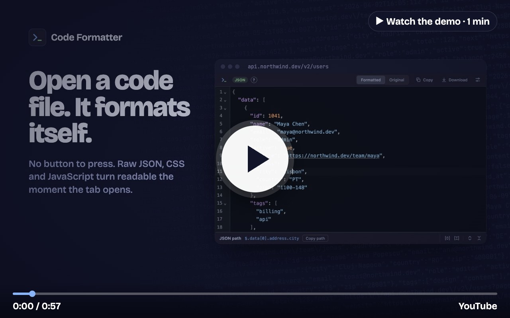
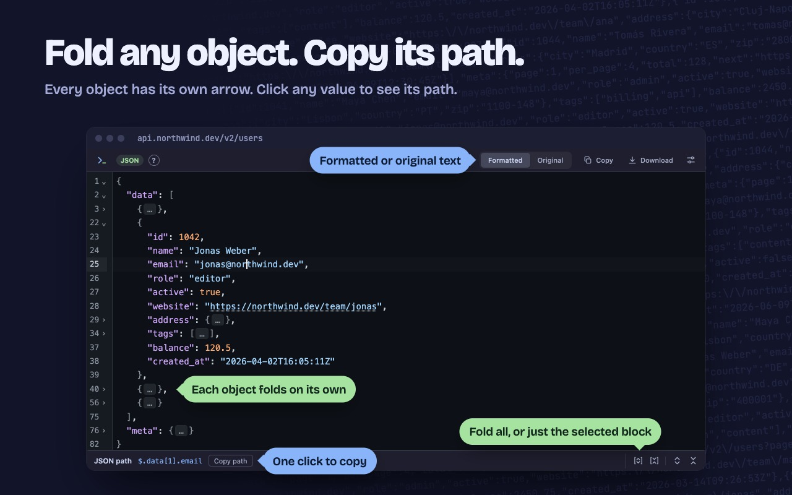
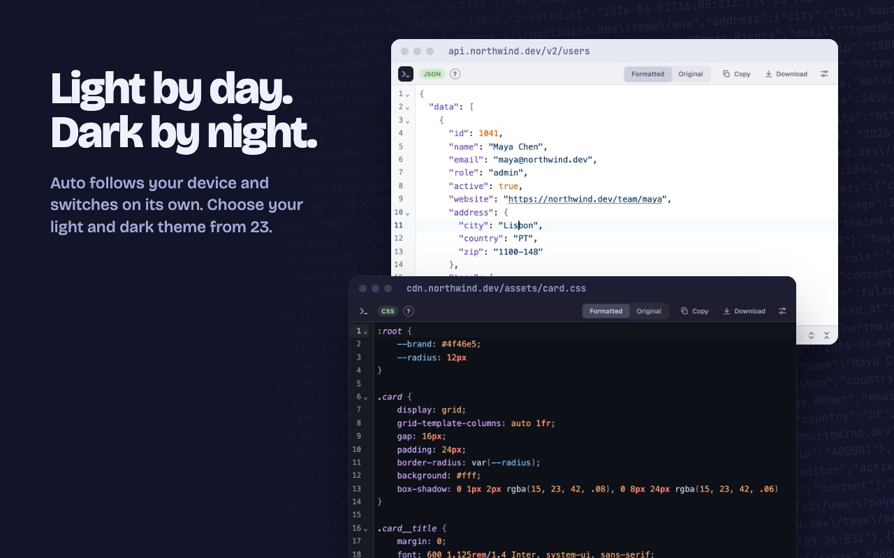
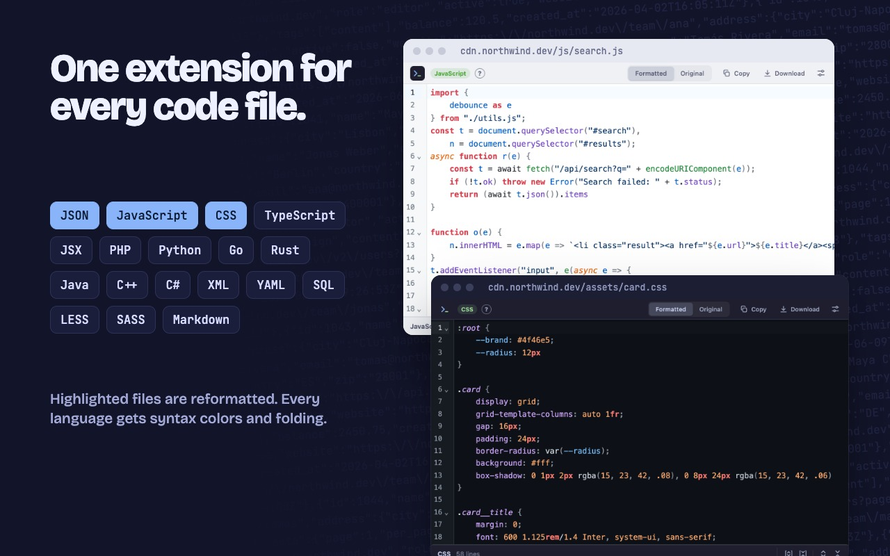
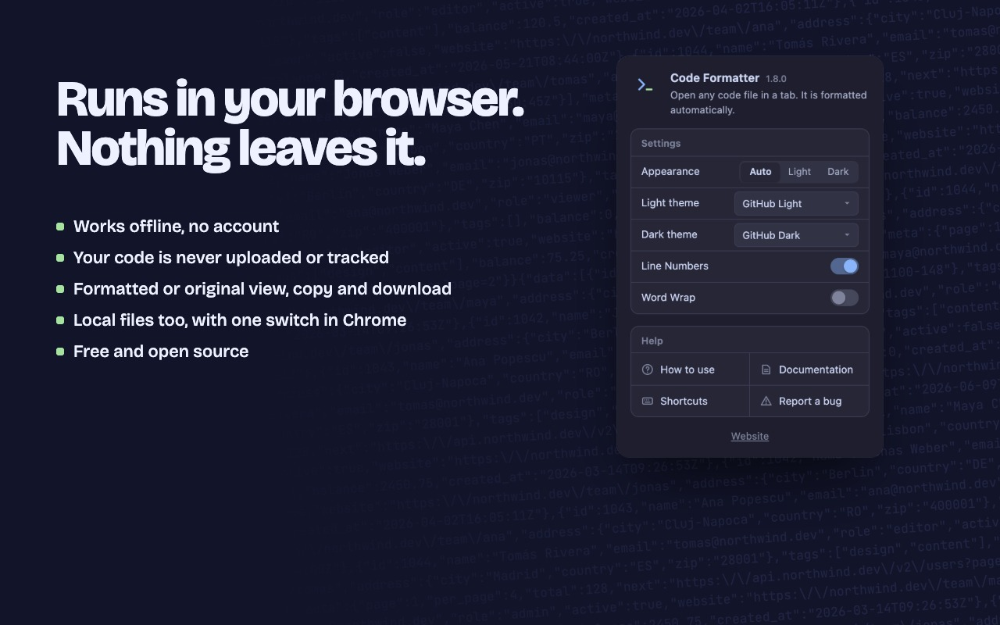

  

# Code Formatter - JSON, CSS & JavaScript

## [Add to Chrome](https://chromewebstore.google.com/detail/bhimnoepicmcjfkbmhckamllnibadfal?hl=en)

<a href="https://www.youtube.com/watch?v=n6z5o0HBGKQ">▶ Watch the 1-minute demo on YouTube</a>

A Chrome extension that makes CSS, JSON, and JavaScript more readable in the browser with syntax highlighting, line numbers, and collapsible sections.

You know how frustrating it is to read code that's not formatted correctly or is minified.

Works directly in your browser when viewing source code. Beyond basic highlighting, it automatically detects and enhances the following code types:

- JSON (json)
- CSS (css)
- JavaScript/TypeScript family (js, ts, jsx, tsx)
- PHP (php)
- Markdown (md)
- XML (xml)
- YAML (yaml, yml)
- LESS (less)
- SASS (sass)
- Python (py)
- SQL (sql)
- Go (go)
- C++ (cpp, cxx, cc)
- Rust (rs)
- Java (java)
- C# (cs)

A treasure for developers and not only.

**Notable Features:**

- Syntax highlighting for easy code understanding
- Auto-beautifies code for better readability
- One-click download or copy formatted code
- Collapsible sections for focused viewing
- Line numbers for easy reference
- JSON path bar: click any key or value to see and copy its path (e.g. `$.users[2].email`)
- Collapse all / Expand all
- Clickable links in JSON (Ctrl/⌘ + click)
- Auto-detects code in raw files and API responses (never touches normal websites)
- Lightweight design that won't slow your browser
- Is open-source and free to use
- Fast - no waiting for code to format and instant results
- Works offline and online
- Support for local files (needs "Allow access to file URLs", see below)
- Supports multiple code types

**Private and secure** - collects no user data.

## How to use

There is nothing to click. Code Formatter works on its own when a tab shows a **raw code file**:

1. **Open a code file in a tab.** A link ending in `.json`, `.css`, `.js`, `.ts`, `.xml`, `.yaml`…, an API URL that returns JSON, or a file from your computer dragged into Chrome.
2. **It is formatted right away.** Minified JSON, CSS and JavaScript are re-indented; every file gets syntax highlighting, line numbers and collapsible blocks.
3. **Use the toolbar at the top** to change the theme, toggle line numbers or word wrap, collapse/expand everything, show the original text, copy or download.

It does **not** change code snippets shown inside normal websites, forums or online editors.

### Files from your computer (file://)

Chrome blocks extensions from local files until you allow it (one time):

1. Open `chrome://extensions` and click **Details** on Code Formatter (or click the extension icon → **Open extension settings**).
2. Turn on **Allow access to file URLs**.
3. Reload the tab with your file.

The extension icon shows a **!** badge when a local code file could not be formatted because this switch is off.

### Working with JSON

- Click any key or value: its path appears in the bar at the bottom. **Copy path** copies it.
- Click the arrows next to the line numbers to collapse an object or array. **Collapse all** keeps the top level open so you can drill down level by level.
- Use the buttons at the bottom right (or the shortcuts) to fold whole sections:

  | Action | Windows / Linux | Mac |
  |---|---|---|
  | Expand selected block (and everything inside) | `Ctrl+Alt+=` | `⌃⌥=` |
  | Collapse selected block | `Ctrl+Alt+-` | `⌃⌥-` |
  | Expand all | `Ctrl+Alt+]` | `⌃⌥]` |
  | Collapse all | `Ctrl+Alt+[` | `⌃⌥[` |
- Hold Ctrl (⌘ on Mac) and click an underlined link to open it.
- Press Ctrl+F (⌘+F) to search.

## [Get it on Chrome Web Store](https://chromewebstore.google.com/detail/bhimnoepicmcjfkbmhckamllnibadfal?hl=en)

## Screenshots

